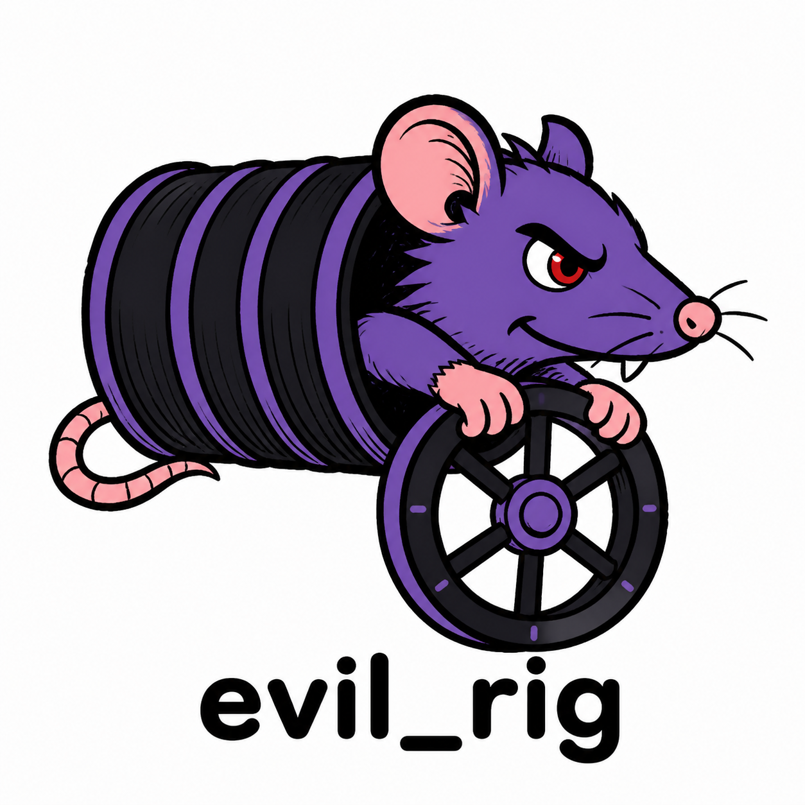
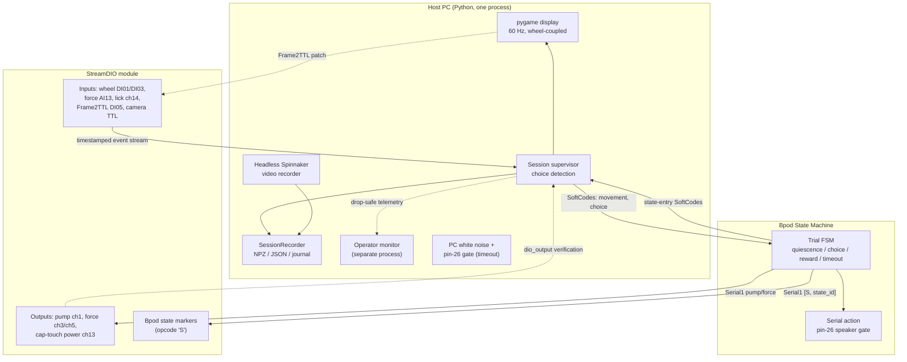
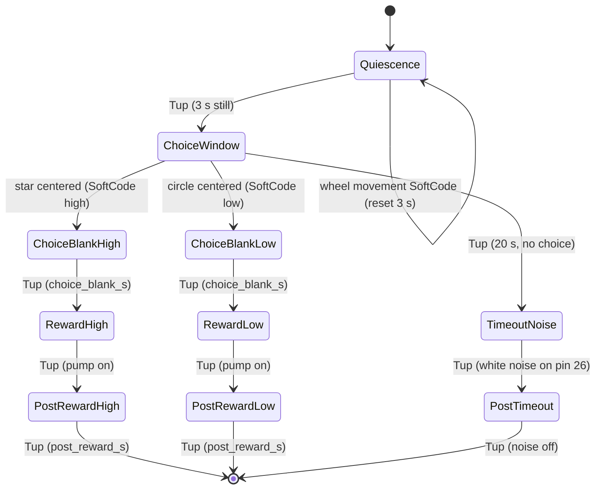

# evil_rig — Head-Fixed Decision-Making (`hf_dm`)



[](https://github.com/andrestrocyte/evil_rig/actions/workflows/ci.yml)
[](https://www.python.org/)
[](#license)

A **head-fixed, effort-based decision-making task** for mice, built on
[**bpod-core**](https://github.com/int-brain-lab/bpod-core) with **StreamDIO** hardware. A mouse
turns a wheel to bring one of two visual targets to screen center: a **star** (high effort / high
reward) or a **circle** (low effort / low reward). The rig records wheel kinematics, applied force,
licks, video, and screen-sync pulses on a common time base, with crash-safe data capture and
post-session quality control.

> **Design references:** the two-alternative choice structure and Frame2TTL screen-sync philosophy
> of [IBLRIG](https://int-brain-lab.github.io/iblrig/), combined with the **force-discount wheel**
> paradigm from `MM_PyBpod2/examples/screen_shape_force_discount_task.py`.

---

## Windows rig launcher

For daily Windows operation, open **evil_rig** on the desktop or double-click
`Start-Rig.cmd`. Choose the subject, trial counts and lick sensor, then **Start
session**. **Check rig** runs a finite bench check (about 50 seconds here);
**Watch inputs (20 s)** displays physical sensor responses. **Stop** saves the
interrupted session and verifies cleanup. These diagnostics are on-demand;
ordinary sessions retain lightweight acquisition health checks.

Stop allows 30 seconds for hardware shutdown. After verified cleanup, large
exports get a separate five-minute limit; saved-data validation also runs with a
five-minute timeout in its own process. A timed-out writer leaves recovery data
intact and reports failure.

To install a new checkout with Python 3.12 and the camera SDK already installed:

```powershell
powershell -NoProfile -ExecutionPolicy Bypass -File .\scripts\install_rig.ps1
```

This creates a local `.venv`, installs locked runtime dependencies and the pinned
StreamDIO driver, and adds a desktop shortcut. Add `-Dev` for test tools. Each
launch saves its configuration, console log, result and data validation under
`data/runtime/operator/runs/`; session bundles go to the selected data directory.
Animal mode retains the existing calibration, welfare and rig certification
requirements. See [current audit evidence and limits](docs/QUALITY_AUDIT_2026_10.md).

The camera records every received frame at the configured trigger rate. The GUI
uses a separate 15 fps preview of recent frames; on this rig its measured host
frame age is about 74 ms median / 89 ms p95. Preview timing is not the acquisition
timestamp. The saved session compares frame counts with recorded camera triggers.

## Table of contents

- [Why this repo](#why-this-repo)
- [Key features](#key-features)
- [System architecture](#system-architecture)
- [Trial structure](#trial-structure)
- [Hardware contract](#hardware-contract)
- [Installation](#installation)
- [Quick start](#quick-start)
- [Configuration reference](#configuration-reference)
- [Running a session](#running-a-session)
- [Diagnostics & hardware validation](#diagnostics--hardware-validation)
- [Counterbalancing, calibration & welfare](#counterbalancing-calibration--welfare)
- [Data outputs](#data-outputs)
- [Command reference](#command-reference)
- [Operator monitor](#operator-monitor)
- [Recovery & quality control](#recovery--quality-control)
- [Testing & CI](#testing--ci)
- [Repository layout](#repository-layout)
- [Troubleshooting](#troubleshooting)
- [Learning curricula](#learning-curricula)
- [License](#license)

---

## Why this repo

This is a **single-process rig application** (no web server, database, or network ports) that talks
to hardware over USB/serial. It is deliberately split so that the right component owns each
responsibility:

- **Bpod owns trial time** — quiescence, choice timeout, reward, and timeout states run on the Bpod
  state-machine clock, not on the host OS scheduler.
- **Python owns the visual loop and supervision** — it renders the wheel-coupled display at 60 Hz,
  reads the StreamDIO event stream, detects the centered choice, and verifies pump/force outputs
  from timestamped `dio_output` events (Bpod FSM actuates via Serial1).
- **StreamDIO owns the fast, timestamped data stream** — wheel pulses, force ADC, licks, camera
  TTLs, Frame2TTL edges, Bpod state markers, and the permanent 100 ms timing heartbeat are all
  timestamped by one module clock.

The result is IBL-style rigor (multi-clock logging, screen sync, verified outputs, session bundles,
QC) on a compact, hardware-specific stack.

---

## Key features

| Area | What you get |
|------|--------------|
| **Trial control** | Bpod-core FSM owns quiescence, 20 s choice timeout, reward, and timeout; host supervises the wheel/display at 60 Hz |
| **Effort paradigm** | Star (high-effort/high-reward) vs circle (low-effort/low-reward) with pixel-matched masks; `force`, `risk`, and `delay` modalities |
| **Screen sync** | Frame2TTL v3 photodiode + per-trial pulse-count **barcode** + 1 ms Bpod `*_Pre` state markers |
| **Verified outputs** | Bpod FSM actuates pump/force via Serial1; each transition must produce a timestamped physical `dio_output` event on StreamDIO |
| **Video** | Headless Spinnaker (FLIR) recording with per-frame camera + host timestamps; optional offline FFV1 preview |
| **Multi-clock data** | Wall + monotonic `perf_counter` + StreamDIO module timestamps, with an export-time affine alignment fit and always-on 100 ms Teensy-to-PC heartbeat QC |
| **Crash safety** | Append-only `session.journal.jsonl`, fsync per completed trial, atomic NPZ/JSON writes, `recover-session` |
| **Counterbalancing** | Opt-in blocked side balancing + consecutive-run caps (defaults preserve historical Bernoulli draw) |
| **Calibration & welfare** | Guided valve calibration → µL annotation; per-subject weight/water log |
| **QC** | `session-qc` PASS/WARN/FAIL on response rate, matched rate, RT, loop stalls, missed 100 ms heartbeats, delivery jitter, and accumulated PC-versus-Teensy clock lag |
| **Operator monitor** | Separate-process GUI: camera preview, task mirror, FSM state, force/wheel traces, lick/pump/noise rails |
| **Validation** | Semantic config validation, no-trial preflight, and typed `name/status/detail/hint` diagnostic results |
| **CI** | Ruff + mypy + hardware-free pytest on Windows and Linux |

---

## System architecture



**Responsibility split**

| Component | Owns | Does **not** own |
|-----------|------|------------------|
| **Python supervisor** | display, wheel reading, choice SoftCodes, output verification, cleanup all-off, data | trial timing authority, pump/force actuation during trials |
| **Bpod FSM** | trial clock (quiescence, timeout, reward, blank, post states), pump/force timing, speaker gate | display, wheel reading |
| **StreamDIO** | timestamped input stream, physical outputs, state markers | decision logic |

The task does **not** read rig parameters from a sister checkout — all pin/channel/timing defaults
live in `src/hf_dm/hardware/bringup_constants.py` and `configs/*.yaml`. `MM_PyBpod2` is needed only
as the installed driver package for `pybpod_streamDIO_module`.

---

## Trial structure

During the `decision_making` phase, every trial runs a fresh Bpod FSM while Python supervises the
display:



1. **Quiescence (3 s):** any streamed wheel movement sends a reset SoftCode and restarts the
   Bpod-owned stillness timer.
2. **Choice window (20 s):** a star and a circle start on opposite lateral sides (pixel-matched
   masks). Python redraws at 60 Hz — turning **right** moves only the **left** option toward center;
   turning **left** moves only the **right** option toward center. Bpod's `Tup` is the authoritative
   timeout.
3. **Choice:** when a shape is centered, Python sends one high/low SoftCode. Bpod enters the blank
   state, turns force off, waits `choice_blank_s`, runs the pump state, then holds `post_reward_s`.
4. **Timeout:** Bpod enters the timeout state, gates audible white noise on pin 26 for
   `timeout_noise_s`, then holds `post_timeout_s`.
5. After the FSM completes, the host holds a black screen for `inter_trial_min_s` (default 3 s,
   logged as `iti_start`/`iti_end`), then a fresh FSM starts the next trial.

Pump and effort outputs are actuated by the Bpod FSM over Serial1 and **verified** on StreamDIO:
each transition must produce a timestamped physical `dio_output` event. The host observes those
events asynchronously and does not re-actuate during normal trials.

**Modalities** (`task.modality`): `force` applies a physical force cue toward the star side;
`risk` makes the star reward probabilistic (`risk_star_probability`); `delay` adds
`delay_star_extra_s` before the star reward.

---

## Hardware contract

The rig configs set `display.invert_wheel_movement: true` to reverse wheel-driven
screen movement. This setting preserves CW force on pin 21 and CCW force on pin 19,
and preserves the encoder's CW/CCW pulse labels. Choice and reward mapping follow
the shape moved to the center. Set it to `false` for the original screen direction.

All channels/pins match the `MM_PyBpod2` bringup notebooks. **Ports default to `AUTO`** with the
same discovery logic as the screen task.

| Function | StreamDIO channel | Teensy pin | Source notebook |
|----------|------------------|-----------|-----------------|
| Wheel pulse | DI01 (input ch1) | pin 2 | `rotary_encoder_bringup.ipynb` |
| Wheel direction | DI03 (input ch3) | pin 4 | `rotary_encoder_bringup.ipynb` |
| Force ADC | AI13 (analog ch13) | pin 14 | `rotary_encoder_bringup.ipynb` |
| Pump (reward) | output ch1 | pin 23 | `screen_bringup_shape_force_discount.ipynb` |
| CW force | output ch3 | pin 21 | `screen_bringup_shape_force_discount.ipynb` |
| CCW force | output ch5 | pin 19 | `screen_bringup_shape_force_discount.ipynb` |
| Cap-touch power | output ch13 | pin 15 | `cap_touch_bringup_pin15_power_pin14_touch.ipynb` |
| Lick (cap-touch) | input ch14 | pin 25 | `cap_touch_bringup_pin15_power_pin14_touch.ipynb` |
| Camera TTL | StreamDIO 30 Hz, 10 ms | pin 32 | `camera_bringup_pin32_ttl.ipynb` |
| Speaker gate | Bpod Serial1 action | pin 26 | `speaker_bringup_pin27_whitenoise.ipynb` (original pin 27, remapped in this firmware) |
| Frame2TTL v3 | DI05 (input ch5) | pin 6 | `frame2ttl_v3_bringup_di05_pin6.ipynb` |

**Notes**

- When capacitive touch is selected, its power is held high for the whole session; lick edges on input ch14 are stored both as
  raw module-timestamped events and as explicit `lick` session events.
- The firmware streams **one** analog input at a time, so force stays on AI13 and the vendored
  StreamDIO firmware (`firmware/`) digitizes cap-touch pin 25 locally into channel-14 high/low
  events. Flash it if the detector LED changes but no lick events appear.
- The Sanworks `pybpod_rotaryencoder_module` is intentionally **not** used — the wheel is read via
  StreamDIO DI01/DI03.
- Defaults: baudrate `1312500`, wheel radius `31.5 mm`, `1024` ticks/rev, gain `4.0 deg/mm`,
  Bpod serial channel `1`.

---

## Installation

**Requirements:** Python 3.12, a Windows rig (same as the bringups) for live hardware, and Bpod
State Machine 2+. Tests and simulation are hardware-free and cross-platform.

On the rig, install the locked environment from PowerShell:

```powershell
cd C:\path\to\evil_rig
py -3.12 -m venv .venv
.\.venv\Scripts\Activate.ps1
python -m pip install -r requirements.lock
python -m pip install --no-deps "MM-PybBod2 @ git+https://github.com/andrestrocyte/MM_PyBpod2.git@a176c0e38520a4f29554198ae30711a08546d75d"
python -m pip install -e . --no-deps
```

The MM commit above contains neutral, port-free settings and only its StreamDIO dependency is used;
rig ports still come from `configs/*.yaml`. Deploy from this checkout with an editable install: the
checkout remains the source of the rig profiles, firmware, and operator documentation.

**Optional extras**

```bash
pip install -e ".[video]"   # offline FFV1 preview-video exporter (OpenCV)
pip install -e ".[mm]"      # MM-style cold-path helpers (soundcard + OpenCV)
pip install -e ".[sound]"   # pybpod soundcard module
pip install -e ".[dev]"     # pytest, mypy, ruff, types-PyYAML
```

**Live-hardware drivers** (`pybpod_streamDIO_module` from `MM_PyBpod2`, the Spinnaker SDK / `PySpin`,
and the sound module) are imported lazily — they are only needed when connecting to a real rig, not
for tests or simulation.

### Headless Spinnaker recording

Install the **Teledyne/FLIR Spinnaker SDK** and set `camera.backend: spinnaker`. The recorder uses
`PySpin` when available and falls back to the Spinnaker C API otherwise. Both configure the verified
bringup trigger contract (`FrameStart`, `Line0`, rising edge, `TriggerWidth` exposure). With
`camera.required: true`, the task refuses to run if recording cannot start.

Both backends save Mono8 pixels directly as full-resolution, lossless PGM and
publish previews before writing the image. The preview keeps the latest frame;
the recording preserves all acquired frames. Required enum/bool settings and ROI
are checked by readback. ROI changes restore the original crop on failure;
unspecified ROI values retain the camera's current crop. Recording metadata and
the startup journal distinguish requested ROI from actual settings, including
gain and gamma state. Float readbacks preserve camera quantization. Exposure is
controlled by the StreamDIO trigger width; `ExposureTime` readback describes the
temporary Timed-mode setting, not a separate measurement of exposure duration.

`frame_timestamps.csv` retains its existing camera timestamp and post-save host
columns. New `received_wall_time_s` and `received_monotonic_s` columns record host
receipt immediately after image acquisition, before preview/copy/save work.
Neither host timestamp is the physical exposure time; use camera and StreamDIO
timestamps for scientific timing. Non-Mono8 formats retain SDK saving.

Startup failures release the resources already opened and preserve the original
error. Shutdown releases images before cameras and SDK resources; a failed release
retains its handle for a retry and prevents a successful cleanup report. Recording
summaries separate the current `cleanup_error` from `cleanup_error_history`, which
survives successful retries. Create a new recorder for each recording; restarting
the same instance is rejected before it can overwrite frames or timestamp files.

Teledyne distributes `PySpin` separately from PyPI. Install only the `spinnaker_python` wheel whose
SDK version, operating system, architecture, and CPython tag exactly match the rig (for the installed
Spinnaker 4.0.0.116 SDK, the vendor Windows wheel is a CPython 3.10 build). Do **not** install the
unrelated package named `pyspin` from PyPI. Python 3.12 rigs remain fully supported through the
installed Spinnaker C API fallback.

Session journals and the StreamDIO WAL request durable flushes. Store animal data on a local volume
that supports `FlushFileBuffers`/`fsync`; unsupported virtual or shared filesystems produce an
explicit reduced-durability warning. A live session also arms
`~/.hf_dm/hardware_cleanup_interlock.json`; verified cleanup removes it, while a crash or any failed
all-off action leaves the next live startup blocked for manual inspection.

---

## Quick start

**1. Validate your config** (no hardware touched):

```bash
hf-dm validate-config configs/dm_50.yaml
```

**2. Run a hardware-free simulation** to exercise the full task loop before touching the rig:

```bash
python -m hf_dm.cli --config configs/dm_50.yaml \
  --simulate --simulate-headless --simulate-trials 3 --simulate-choice-mode alternate
```

Drop `--simulate-headless` to open the pygame window. Choice modes: `matched`, `opposite`,
`timeout`, `cw`, `ccw`, `alternate` (in the DM task, *matched* = star/high-effort, *opposite* =
circle/low-effort).

**3. On the rig**, use preflight during setup or troubleshooting. The shipped animal profiles are intentionally fail-closed: a
session will not open hardware until the exact release/config/calibration has a current PASS
certificate and the operator confirms that this is an animal-use run.

Certification binds the clean Git commit, installed driver source hash, effective
hardware/task settings and calibration. A Git tag is optional. Subjects, session
paths, random seeds and trial counts can change without repeating commissioning;
the calibrated reward ceiling is checked against the selected trial count on
every run. Changing sensor, modality, timing or reward settings still changes the
certified configuration. Existing certificates need regeneration after this code update.

```bash
python -m hf_dm.cli --config configs/dm_50.yaml --preflight --preflight-duration 2
python -m hf_dm.cli --config configs/dm_50.yaml --confirm-animal-use
```

> On the Windows rig, `python -m hf_dm.cli ...` is the reliable launcher. The editable
> `hf-dm-run.exe` may land in `%APPDATA%\Python\Python312\Scripts`, which is not always on
> PowerShell's `PATH`.

---

## Configuration reference

Configs are YAML, loaded by `SessionConfig.from_yaml`. Every field is validated semantically before
hardware opens. Four profiles ship in `configs/`:

| Profile | Phase | Trials | Notable settings |
|---------|-------|--------|------------------|
| `centering_50.yaml` | `centering` | 50 | `centering_threshold_deg: 8.0` shaping |
| `dm_50.yaml` | `decision_making` | 50 | full task, bounded raw-event working history |
| `dm_100.yaml` | `decision_making` | 100 | standard volume |
| `dm_200.yaml` | `decision_making` | 200 | `streamdio_chunk_s: 45`, `streamdio_memory_mode: bounded` |

### Top-level keys

| Key | Default | Meaning |
|-----|---------|---------|
| `subject_id` | `mouse01` | subject identifier |
| `phase` | `decision_making` | `centering` or `decision_making` |
| `n_trials` | `50` | total trials |
| `random_seed` | `null` | seed for side draws / schedules |
| `centering_threshold_deg` | `8.0` | reward radius for the centering phase |
| `results_dir` | `data/sessions` | output root |

### Section summary

| Block | Purpose | Key fields |
|-------|---------|-----------|
| `ports` | COM ports | `bpod_port`, `dio_config_port`, `dio_stream_port`, `baudrate`, `bpod_serial_channel` (all `AUTO`) |
| `timing` | FSM timers (s) | `quiescence_s` 3, `choice_timeout_s` 20, `choice_blank_s` 1, `post_reward_s` 1, `timeout_noise_s` 2, `post_timeout_s` 1, `inter_trial_min_s` 3, `choice_loop_stall_s` 0.1 |
| `wheel` | kinematics | `wheel_radius_mm` 31.5, `encoder_ticks_per_rev` 1024, `gain_deg_per_mm` 4.0 |
| `reward` | pump | `matched_pump_s` 0.08, `opposite_pump_s` 0.04, `calibration_path` (opt) |
| `task` | design | `modality` (`force`/`risk`/`delay`), `n_free_trials`, `n_forced_trials`, `risk_star_probability` 0.66, `delay_star_extra_s` 2.0, `side_balancing`, `max_consecutive_side`, `max_consecutive_forced` |
| `display` | stimulus | `distance_mm` 100, `pixel_size_mm` 0.114, `choice_distance_deg` 35, `choice_center_threshold_deg` 1.0, `rotated_choice_axis` true, `display_index` 1, `fps` 60, `feedback_hold_s` 0.6, colors |
| `frame2ttl` | screen sync | `enabled`, `input_channel` 5, `input_pin` 6, `patch_size_px` 64, `patch_corner` bottom_right, barcode frame counts, `choice_flash_enabled` |
| `licks` | cap-touch | `channels` [14], `power_output_channel` 13, `power_required`, `cap_touch_min_high_threshold`, `cap_touch_delta_high`, `cap_touch_delta_low` |
| `speaker` | white noise | `sample_interval_us` 100, `frequency_hz` 6000, `volume` 1.0, `gate_active_high`, `required` |
| `engagement` | auto-stop | `idle_timeout_s` 60, `max_consecutive_failures` 10 |
| `camera` | Spinnaker | `frequency_hz` 30, `exposure_us` 10000, `record_video`, `required`, `backend`, `serial_number`, `pixel_format`, ROI fields, `save_dir` |
| `video` | cold export | `export_spinnaker_summary`, `duplicate_preview_video`, `preview_video_codec` FFV1 |
| `integrations` | optional | `mm_soundcard_status`, `mm_alyx_register`, `mm_flir_roi_gui`, `alyx_*` |
| `welfare` | colony | `subjects_dir` subjects, `water_target_ml`, `append_session_water` |
| `animal_use` | release gate | `enabled`, `certification_path`, age/residual limits, `require_clean_git`, `require_local_storage`, peripheral requirements, `hardware_failsafe_revision` |
| `monitor` | operator GUI | `enabled`, `display_index` 0, sizes, sample rates, `streamdio_status_interval_s` 30, `record_path` |
| `session_export` | data products | `layout` (`mm_hierarchy`/`flat`), `manifest`, `config_snapshot`, `export_csv_on_finalize`, `export_timeline`, `streamdio_chunk_s`, `streamdio_memory_mode`, `streamdio_recent_events`, `streamdio_wal_fsync_s` |

CLI flags and the session-setup dialog can override several of these per run; every override is
recorded in `session_export.cli_overrides` and the config snapshot.

---

## Running a session

### Session setup dialog

By default, `hf-dm.cli` opens a small Tk dialog to choose the **mouse folder**, **modality**,
**profile**, **free/forced trial counts**, **lick sensor**, and **session name** before the task starts. Bundled
profiles:

| Profile | Free | Forced |
|---------|------|--------|
| `50 free` / `100 free` / `200 free` | 50 / 100 / 200 | 0 |
| `50 forced` / `100 forced` / `200 forced` | 0 | 50 / 100 / 200 |
| `50 50/50` / `100 50/50` / `200 50/50` | 25 / 50 / 100 | 25 / 50 / 100 |

Skip the dialog with `--no-session-dialog`, or drive it non-interactively:

```bash
python -m hf_dm.cli --config configs/dm_50.yaml --no-session-dialog \
  --session-mouse-dir data/sessions/mouse01 --session-modality force \
  --session-profile "50 50/50" --session-name 20260629_force_5050
```

### Selecting the lick sensor

Both sensors can remain connected. Choose `capacitive` (default) or `optical` in the session
setup dialog, or pass `--lick-source optical --lick-port 1` with `--no-session-dialog`.
The selected source supplies the GUI lick indicators, session lick events, and trial counts;
the other source does not contribute lick counts. The saved config records the selection.

For the Sanworks optical lickometer, connect **Bpod behavior port 1 → RJ45 cable → port
interface board → photogate**. Keep StreamDIO on Bpod **module port 1**, and leave the
capacitive signal on StreamDIO pin 25. See the official
[lickometer assembly](https://sanworks.github.io/Bpod_Wiki/assembly/lickometer-assembly/) and
[port interface board assembly](https://sanworks.github.io/Bpod_Wiki/assembly/port-breakout-board-assembly/) instructions.
The lickometer receives power through the port interface board. This task does not operate
that board's valve or cue LED; reward delivery remains on the StreamDIO pump output.

```yaml
licks:
  source: optical       # capacitive or optical
  bpod_port: 1          # behavior port, not module port
  optical_clock: streamdio  # bpod: original edges; streamdio: forwarded receipt timestamps
  channels: [14]        # StreamDIO inputs used only for capacitive touch
```

Optical `Port1_High` counts a lick and `Port1_Low` clears the indicator (`high_only: true`).
MATLAB-style `Port1In`/`Port1Out` names are also supported. Both
edges retain Bpod hardware timestamps in the lick event log, with `source: bpod_optical`
and `clock: bpod_session`; these timestamps use Bpod's session clock, while capacitive
events use StreamDIO's clock. An output-free Bpod observation state captures optical
events during ITIs and preflight. Short host gaps between state machines are not recorded.
Capacitive power is switched off for optical sessions. No StreamDIO firmware change is needed.

For unchanged wiring and a StreamDIO timestamp, select `streamdio` under **Optical timestamp
clock** in session setup, or pass `--lick-source optical --lick-clock streamdio --lick-port 1`.
Bpod records the physical edge; Python forwards one `['I', 'P', port, state]` marker through
Bpod's existing module UART connection. StreamDIO firmware 5 already timestamps these
markers as raw `port_input` events. The GUI and trial lick counts use the paired receipt.
Only one marker is outstanding, and missing/mismatched receipts stop acquisition rather
than silently substituting a timestamp from another clock. Reward, force and state timers
continue to run on Bpod without additional lick-related state transitions.

**Timing meaning:** `timestamp_us` is the StreamDIO UART-receipt time, not the original
photogate edge time. This route includes Bpod-to-PC, host polling, and return USB/UART delay.
`bpod_timestamp_us`, `bpod_relative_time_s`, and the original raw Bpod row preserve the
physical edge time. `timestamp_origin: streamdio_uart_receive` and `relay_receipt_wait_s`
identify receipt timestamps and the send-to-receipt host interval; that interval does not
measure the entire edge-to-receipt delay. Both clocks are exported in `licks.csv` and the
journal. Use the original Bpod timestamps for precise lick intervals. A physical split to
a voltage-converted StreamDIO input would be required for direct same-clock edge capture.
Shipped YAML files prefer StreamDIO receipts; older configs without `optical_clock` keep
the working Bpod edge-time path. Capacitive licks remain direct StreamDIO events.

### Training stages

```bash
# Stage 1 — centering shaping (bring a lateral cue to center)
python -m hf_dm.cli --config configs/centering_50.yaml

# Stages 2–4 — full DM (50 / 100 / 200 trials)
python -m hf_dm.cli --config configs/dm_50.yaml
python -m hf_dm.cli --config configs/dm_100.yaml
python -m hf_dm.cli --config configs/dm_200.yaml

# Without the operator GUI
python -m hf_dm.cli --config configs/dm_50.yaml --no-monitor
```

See [docs/CURRICULUM_TRAINING.md](docs/CURRICULUM_TRAINING.md) for stage criteria.

---

## Diagnostics & hardware validation

Run these before trials to certify each subsystem. They are mutually exclusive and (except the
self-test) do not start Bpod trials.

| Command | Checks |
|---------|--------|
| `--preflight [--preflight-duration N]` | Connect Bpod/StreamDIO/Spinnaker streams, hold N s, clean up. Turn the wheel and touch the lick sensor; `preflight_end` reports wheel/lick edges |
| `--hardware-self-test` | **Activates real outputs.** Runs 3 production-FSM trials with synthetic choices; asserts force/pump events, choice→pump timing, pump error < 10 ms, force ADC + camera TTLs, timeout gate, frame saves, no loop stalls |
| `--cap-touch-diagnostic [--cap-touch-duration N]` | StreamDIO-only: powers ch13/pin15, polls digitizer on ch14/pin25, reports ADC/baseline/threshold + hi/lo lick edges |
| `--frame2ttl-diagnostic [--frame2ttl-flips N]` | Flashes the sync square, counts DI05 edges |
| `--frame2ttl-barcode-diagnostic` | Displays representative count barcodes, reports decode/match accuracy |
| `--bpod-opcode-diagnostic` | Sends Bpod state-marker opcodes, reports `bpod_state` timestamps reaching StreamDIO |
| `hf-dm certify-rig` | **Activates real outputs.** Runs the complete machine certification and merges signed instrument evidence into the certificate consumed by the animal-use startup gate |

```bash
python -m hf_dm.cli --config configs/dm_50.yaml --preflight --preflight-duration 2
python -m hf_dm.cli --config configs/dm_50.yaml --hardware-self-test
python -m hf_dm.cli --config configs/dm_50.yaml --cap-touch-diagnostic --cap-touch-duration 15
python -m hf_dm.cli --config configs/dm_50.yaml --frame2ttl-diagnostic --frame2ttl-flips 20
python -m hf_dm.cli --config configs/dm_50.yaml --frame2ttl-barcode-diagnostic
python -m hf_dm.cli --config configs/dm_50.yaml --bpod-opcode-diagnostic
```

Cap-touch thresholds (firmware v4) can be tuned from YAML (`licks.cap_touch_*`) or per run
(`--cap-touch-min-high-threshold`, `--cap-touch-delta-high`, `--cap-touch-delta-low`). Use
`--cap-touch-raw-analog` to temporarily stream pin 25 as the single analog input for a bringup-style
readout.

### Animal-use release gate

The production YAML files set `animal_use.enabled: true`. Startup is blocked unless all of these
match the current run: a clean exact Git tag and commit, dependency lock, config hash, reward
calibration hash and fit quality, hardware failsafe revision, Bpod/StreamDIO/camera identities,
current subject weight/water limits, required peripherals, signed approvals, and a current
all-PASS rig certificate. `WARN` never satisfies this gate.

The unified certification command refuses to actuate until the operator truthfully supplies all
five no-animal safety confirmations:

```powershell
hf-dm certify-rig --config configs/dm_50.yaml `
  --physical-evidence certifications/rig1-physical-evidence.json `
  --confirm-no-animal --confirm-collection-vessel --confirm-force-clear `
  --confirm-speaker-safe --confirm-emergency-stop
```

It runs preflight, the production-FSM hardware self-test, Frame2TTL square and barcode tests, Bpod
opcode transport, and cap-touch diagnostics. A PASS additionally requires traceable oscilloscope,
SPL-meter, force-gauge, geometry, independent failsafe/failure-injection, full-duration soak, and
welfare-protocol evidence. See [Animal-ready release and certification](docs/ANIMAL_READY_RELEASE.md)
and the tracked [physical evidence template](docs/physical_evidence.example.json).

Normal animal-session startup is also interactive. A missing, stale, or mismatched certificate (or
missing calibration, weight/water record, durable storage, welfare cap, or one-run confirmation)
opens the **HF-DM animal-use readiness** desktop window. It shows every failed gate, accepts the
supported operational values, logs subject weight/water, runs guided valve calibration, edits signed
physical-evidence JSON, and launches the same full certification workflow. All actions and command
output are logged beside the ignored certificate. **Start session** stays disabled until the
production gate returns PASS; the GUI never fabricates physical evidence or overrides a failed test.
Use `--no-certification-dialog` only for deliberately non-interactive automation.

To run the complete task for hardware/behavior checking without a certificate, explicitly declare a
no-animal bench run:

```powershell
python -m hf_dm.cli --config configs/dm_50.yaml `
  --allow-uncertified --confirm-no-animal
```

The two flags are inseparable, the run is stored as `run_mode: bench`, and the config snapshot records
the certification bypass. It must not be used for animal acquisition. To open the same calibration
and certification GUI without starting a session, run:

```powershell
hf-dm certification-gui --config configs/dm_50.yaml
```

---

## Counterbalancing, calibration & welfare

Counterbalancing, calibration annotation, and welfare logging retain backward-compatible defaults.
The shipped production profiles additionally enable the fail-closed animal-use gate described above.

```yaml
task:
  side_balancing: blocked      # default "bernoulli" (unchanged historical draw)
  max_consecutive_side: 4      # default 0 = unlimited
  max_consecutive_forced: 2    # default 0 = unlimited

reward:
  matched_pump_s: 0.08
  opposite_pump_s: 0.04
  calibration_path: calibrations/valve_20260629.json   # annotate µL only

welfare:
  subjects_dir: subjects
  water_target_ml: 1.2
  append_session_water: true
```

- **Counterbalancing** is computed at **setup time** (no hot-path change). Blocked sides are drawn
  from the session seed in balanced truncated-geometric blocks; consecutive caps bound run length.
- **Calibration** only annotates delivered reward as `reward_volume_ul` — **pump open-time remains
  the control variable**. Build the table with `hf-dm calibrate-valve` (see below).
- **Welfare:** calibrated sessions append one idempotent row to
  `subjects/<subject>/water_log.jsonl`; log daily weights with `hf-dm log-weight`.

```bash
# Guided valve calibration — WARNING: actuates the real pump
hf-dm calibrate-valve --config configs/dm_50.yaml \
  --durations-ms 20,40,60,80,100 --repetitions 10 --output calibrations/valve_20260629.json

# Daily weight + water target
hf-dm log-weight mouse01 --weight 24.3 --water-target 1.2
```

---

## Data outputs

### Layout

With the production default `session_export.layout: mm_hierarchy`, the primary artifact is:

```
data/sessions/<phase>/<subject>/<YYYY-MM-DD>/<run_id>/session.npz
```

`layout: flat` instead writes `data/sessions/<subject>_<phase>_<timestamp>.npz` + `.json` and a
sibling `*_bundle/` directory. Either way, a cold-path **bundle** is written *after* the primary
NPZ/JSON — the StreamDIO/force/camera/task loops never append CSV rows in the hot path.

```
<run>/
├── session.npz                 # trials, events, raw streamdio_events, bpod_trials_json
├── session.json                # JSON sidecar
├── session.journal.jsonl       # append-only crash journal (fsync per trial)
├── manifest.json               # artifact paths, SHA256, provenance, counts, clock_alignment
├── config.snapshot.yaml        # source path + text + SHA256 + CLI overrides + effective config
├── session.qc.json             # after `hf-dm session-qc`
├── exports/
│   ├── streamdio_events.csv  force_trace.csv  camera_ttl.csv
│   ├── frame2ttl_edges.csv  licks.csv  trials_summary.csv  events.csv
│   ├── synchronized_timeline.csv  alignment_anchors.json
│   ├── streamdio_timing_heartbeat.csv  streamdio_timing_qc.json
│   ├── monitor_telemetry.jsonl       # when monitor record_path: auto
│   ├── rig_preflight_report.json     # after rig-preflight
│   └── alyx_registration.json        # when integrations.mm_alyx_register: true
├── bpod_exports/bpod_trials_flat.csv
├── bpod_data/bpod_trials.json        # exact bpod-core rows + saved FSM definitions
├── continuous_streams/streamdio_chunk_NNN.npz   # when streamdio_chunk_s > 0
└── videos/spinnaker_video.json       # pointer to the Spinnaker recording dir (no frame duplication)
```

The Spinnaker recording directory (`data/videos/<subject>_<phase>_<timestamp>_spinnaker/`) holds the
frame sequence, `frame_timestamps.csv`, and `recording_summary.json` (saved frames, duration, mean
FPS, requested trigger rate, exposure, incomplete/timeout/save-error counters, estimated missing
triggers).

### What is logged

- **Per trial:** star/circle sides, chosen shape/side, force direction, choice, reward duration,
  optional calibrated `reward_volume_ul`, response time, wheel pulses, force ADC stats, lick
  count/timestamps, camera-TTL interval QC, Frame2TTL barcode/edge summary, choice-loop frame stats.
- **Exact Bpod rows** for every trial (JSON + NPZ `bpod_trials_json`).
- **Raw `streamdio_events`** (NPZ): every wheel/direction edge, force sample, camera TTL, lick,
  timing heartbeat, module timestamp, and high-resolution host timestamp. Firmware v5 emits the
  heartbeat every 100,000 us; the PC timestamps that same callback immediately.
- **Semantic events:** `session_start`, `trial_start`, `stimulus_on`, `force_on`, `choice_detected`,
  `feedback_on`, `frame2ttl_*`, `pump_start`, `pump_end`, `output_actual`, `lick`, `white_noise_*`,
  cleanup, `trial_end`, `session_end`.
- **Provenance:** Git commit, dirty-tree flag, package version, and capture time are captured
  **before hardware startup**, written into the first journal row, and retained in the manifest.
- **Clock alignment:** the manifest's `clock_alignment` block stores affine fits
  (`perf_counter→wall`, `streamdio→perf_counter`, `streamdio→wall`) with slope, intercept, anchor
  count, and residuals.
- **Session summary:** end reason (`completed`, `idle_timeout`, `max_consecutive_failures`).

### Long sessions

All shipped profiles bound the raw-event working history to about 50,000 recent
rows. Every raw event is written to the recovery journal (WAL); final NPZ/CSV
exports retain the full stream. `dm_200` also writes optional 45-second NPZ chunks.
Bounding memory does not require those extra chunks. Finalization writes the raw
NPZ array in 8,192-row blocks and streams CSV output; validation also reads the
compressed raw array in blocks. The formats and raw timestamps are unchanged.
Semantic event arrays and JSON-array members also stream, using at most 4 MiB of
array data per block (or one row if a single record is larger). Unicode widths,
field order and values retain the established NumPy representation. The JSON
sidecar streams its text and shares the already-built event dictionaries with
cold exports. Validation reads every semantic-array block, checks counts and JSON
payloads, and rejects truncation, trailing bytes and object/pickle arrays.
Optional chunk output has a two-block queue. If it falls behind, the complete WAL
supplies final exports; if its writer cannot finish, recovery files are retained
instead of publishing a completed session.

The rig checks available space before connecting and every two seconds during
acquisition, stopping through normal cleanup when a recording volume falls below
2 GiB free. Full-resolution uncompressed video still needs substantial space
(about 2.8 GB/min on the installed camera). This reserve is a guard, not a promise
that every possible session's exports will fit. Semantic events, camera timelines
and heartbeat analysis still grow with session length. Normal finalization and
crash recovery both stream the high-rate raw records without full in-memory copies.

### Inspecting a session

```python
import numpy as np

d = np.load("data/sessions/.../session.npz", allow_pickle=True)
trials = d["trials"]
matched = trials["matched"][trials["responded"]]
print(matched.mean(), trials["response_time_s"].mean())
```

---

## Command reference

### `hf-dm` (operational helpers)

| Subcommand | Purpose |
|-----------|---------|
| `validate-config <cfg>` | Semantic config validation, no hardware |
| `session-qc <session>` | PASS/WARN/FAIL on response/matched rate, RT, stalls, frame time → `session.qc.json` |
| `validate-session <bundle>` | Verify manifest paths, sizes, SHA256, NPZ schema, CSV/JSON sidecars, provenance |
| `recover-session <dir>` | Rebuild NPZ/JSON/exports from the journal + chunks after a crash |
| `export-session <json> [--export-preview-video]` | Regenerate derived exports |
| `export-preview-video <dir>` | Offline FFV1 AVI from saved PGM frames |
| `rig-preflight --config <cfg>` | No-trial hardware preflight, writes `rig_preflight_report.json` |
| `certify-rig --config <cfg>` | Unified no-animal, real-output certification; requires five explicit safety confirmations and signed physical evidence |
| `certification-gui --config <cfg>` | Open the desktop calibration/evidence/certification workflow without starting a session |
| `calibrate-valve --config <cfg>` | Guided reward-valve calibration (actuates pump) |
| `log-weight <subject> --weight W` | Append a subject weight/water record |
| `camera-roi-setup --config <cfg>` | Select/write Spinnaker ROI (`--interactive`, `--visual`, `--clear`) |

Console entry points `hf-dm-export-session` and `hf-dm-validate-session` mirror the subcommands.

```bash
hf-dm session-qc data/sessions/decision_making/mouse01/2026-06-28/001
hf-dm validate-session data/sessions/<session>_bundle
hf-dm recover-session data/sessions/decision_making/mouse01/2026-06-28/001
hf-dm rig-preflight --config configs/dm_50.yaml --duration 2 --no-monitor
hf-dm camera-roi-setup --config configs/dm_50.yaml --output configs/dm_50_roi.yaml --visual
```

`session-qc` exposes every threshold as a flag (`--min-responded-rate`, `--min-matched-rate`,
`--max-mean-response-time`, `--max-stalls`, `--max-frame-time`, plus `--warn-*`); a `FAIL` returns a
non-zero exit code.

### `hf-dm.cli` / `hf-dm-run` (run the task)

| Flag group | Flags |
|------------|-------|
| Core | `--config` (required), `--confirm-animal-use` for one certified animal run, `-v/--verbose` |
| Animal / bench | `--allow-uncertified` + `--confirm-no-animal` for explicit bench runs; `--no-certification-dialog` to skip the readiness GUI |
| Modes | `--simulate`, `--preflight`, `--hardware-self-test`, `--cap-touch-diagnostic`, `--frame2ttl-diagnostic`, `--frame2ttl-barcode-diagnostic`, `--bpod-opcode-diagnostic` |
| Simulation | `--simulate-headless`, `--simulate-choice-mode`, `--simulate-trials` |
| Monitor | `--monitor`, `--no-monitor` |
| Session setup | `--no-session-dialog`, `--session-mouse-dir`, `--session-modality`, `--session-profile`, `--free-trials`, `--forced-trials`, `--session-name` |
| Diagnostic tuning | `--preflight-duration`, `--frame2ttl-flips/-hold-s/-settle-s`, `--frame2ttl-barcode-repetitions`, `--bpod-opcode-hold-s`, `--cap-touch-duration/-poll-hz/-raw-analog`, `--cap-touch-min-high-threshold/-delta-high/-delta-low` |

---

## Operator monitor

The official configs run a separate-process monitor on the main screen
(`monitor.display_index: 0`) while the stimulus stays on the behavior display
(`display.display_index: 1`). It receives only nonblocking, drop-safe telemetry, so a slow or closed
GUI never stalls the task loop.

It shows: a low-rate camera preview, a compact left-rotated task-screen mirror, the active Bpod FSM
state, a rolling **psychometric panel** (matched/responded rate, responded-trial mean RT, signed
side bias), a one-row history of the latest 10 outcome icons, lick/pump/noise event rails, raw
cap-touch pin status, a live force-effort ADC trace with a session-held y-max, a Frame2TTL readout
(DI05 edges, last state, barcode decode/match), a Bpod opcode-timeline, and the per-trial wheel
trace.

Use `--no-monitor` for CLI checks or `--monitor` to force it on; `--simulate-headless` disables it
automatically. With `monitor.record_path: auto`, compact JSONL telemetry is written to
`exports/monitor_telemetry.jsonl` (frame bytes replaced by counts). The monitor also records a
bounded StreamDIO module-status snapshot every `monitor.streamdio_status_interval_s`.

---

## Recovery & quality control

**Crash recovery.** The recorder writes records incrementally and fsyncs after every completed
trial, leaving a `*.incomplete.json` marker while the session is open. Recover from the directory,
the marker, or the journal:

```bash
hf-dm recover-session data/sessions/decision_making/mouse01/2026-06-28/001
```

Recovery streams the journal and preserves its exact original bytes before repair.
It repairs only an unfinished final record, including a torn UTF-8 character;
a complete final row missing just its newline is kept. Malformed newline-terminated
rows, invalid schemas and sequence gaps stop recovery. Backups are included in the
manifest, and subsequent recovery attempts and offline exports verify their recorded
checksums. Changed originals get separate backups. Copied sessions require the local
backup files; old absolute paths remain provenance only.

Recovery restores completed trials and Bpod rows and compares the WAL and completed chunks in
blocks. Their common prefix must agree; missing chunk indices, corrupt chunks,
or interior WAL checksum failures stop recovery explicitly. A damaged final WAL
record can be excluded, with its byte count reported and an exact
`.wal.recovery-backup` retained and hashed in the manifest.

Recovery retains existing chunks and writes any missing suffix synchronously in
blocks of at most 8,192 events. It does not replay through the live writer queue
or delete its input chunks. The regenerated NPZ/JSON/exports are validated before
the WAL and incomplete marker are removed. Failed writes or validation leave the
durable inputs and marker available for retry. Validation establishes consistency
of the recovered records; it cannot recreate records that never reached storage.
Recovery creates a manifest even if the original session disabled it, so this
validation also works for sessions with optional exports turned off.

**Session QC.** `hf-dm session-qc` writes `session.qc.json` with PASS/WARN/FAIL for response rate,
matched rate, response time, choice-loop stalls, and worst frame duration. Calibrated sessions also
require a successful subject-water log event. The permanent StreamDIO heartbeat adds missed-pulse,
Teensy-period, PC-delivery-jitter, detrended backlog, and accumulated PC-versus-Teensy clock-rate
checks. Its full dual-clock samples and automatic QC are always exported as
`exports/streamdio_timing_heartbeat.csv` and `exports/streamdio_timing_qc.json`; the operator monitor
shows the live interval and cumulative difference.

**Validation.** `hf-dm validate-session` checks manifest paths/sizes/SHA256, source-config
provenance, NPZ schemas/counts, StreamDIO chunk NPZs and their index, CSV row counts (incl. Bpod
flat rows and timeline schema/order), JSON/JSONL sidecars, derived Bpod/video summaries, Alyx
registration, the debug-event ring, the rig-preflight report, recorder stats, hardware flags,
timeline anchors, and stream/module/status consistency.

---

## Testing & CI

```bash
pytest                              # hardware-free, headless
ruff check src tests                # correctness lint
mypy src/hf_dm/config.py src/hf_dm/data/recorder.py src/hf_dm/data/session_export.py src/hf_dm/data/raw_stream.py src/hf_dm/data/session_journal.py src/hf_dm/data/array_stream.py
```

GitHub Actions runs Ruff, the stable-module mypy gate, and the full pytest suite on **Windows and
Linux** (Python 3.12, dummy SDL video/audio). Tests are hardware-free: a `SimulatedHFDecisionSession`
drives the real controller path with mocked Bpod/StreamDIO. They cannot establish Bpod clock drift,
USB load timing, acoustic/force/valve safety, or power-loss behavior on a particular rig. The
`certify-rig` workflow combines live diagnostics with signed instrument and failure-injection
evidence; only its exact all-PASS certificate unlocks an animal session.

For audio/display-less environments, export `SDL_VIDEODRIVER=dummy SDL_AUDIODRIVER=dummy`.

---

## Repository layout

```
src/hf_dm/
├── cli.py                  # task launcher (hf-dm-run / python -m hf_dm.cli)
├── ops_cli.py              # operational helpers (hf-dm)
├── config.py               # SessionConfig dataclasses + YAML + validation
├── session/
│   ├── controller.py       # HFDecisionSession orchestration
│   ├── runners/            # decision + centering trial runners, simulated bpod
│   ├── simulated.py        # hardware-free simulation
│   ├── hardware_self_test.py, cap_touch_diagnostic.py
├── fsm/
│   ├── builders.py         # production host-supervised decision FSM
│   ├── reference/          # validation-only reference FSM templates
│   ├── runtime.py, relay.py, softcodes.py
├── streamdio/              # client, wheel, outputs
├── display/pygame_display.py
├── frame2ttl.py            # barcode encode/decode
├── camera/                 # Spinnaker recorder + ROI GUI
├── monitor/                # operator GUI
├── data/                   # recorder, session_export, session_bundle, video_export, alyx
├── certification.py, rig_certification.py, certification_gui.py, safety_interlock.py
├── session_qc.py, valve_calibration.py, subject_log.py, validation.py, durable_io.py
└── hardware/               # bringup_constants, discovery
configs/                    # centering_50, dm_50, dm_100, dm_200
firmware/                   # vendored StreamDIO firmware + ArCOM
docs/                       # training & bpod-core curricula
tests/                      # hardware-free pytest suite
```

---

## Troubleshooting

| Symptom | Fix |
|---------|-----|
| `hf-dm-run` not found (Windows) | Use `python -m hf_dm.cli ...` |
| bpod-core settings lock held | This task uses `data/runtime/bpod-core`; override with `HF_DM_BPOD_CORE_CONFIG_DIR`. Close the older `hf_dm.cli` process and rerun preflight |
| StreamDIO `Access is denied` (COM7/COM8) | Another process owns the port — close notebooks/serial monitors/task processes; unplug/replug StreamDIO |
| Detector LED changes but no licks | Flash the vendored `firmware/`; check cap-touch wiring/power, then thresholds |
| Camera preview falls seconds behind | Both Mono8 backends now write raw PGM directly and preview from memory before saving, bypassing the slow SDK image encoder. The Video age indicator includes acquisition-to-GUI transit. See [rig bringup notes](docs/RIG_BRINGUP_2026_10.md) for measured results |
| Frame2TTL sees no transitions | Run `--frame2ttl-diagnostic`; confirm the photodiode is over the lower-right patch |
| No `bpod_state` markers | Run `--bpod-opcode-diagnostic` to verify state markers reach StreamDIO |

---

## Learning curricula

- **[docs/CURRICULUM_BPOD_CORE.md](docs/CURRICULUM_BPOD_CORE.md)** — become fluent in bpod-core using this repo
- **[docs/CURRICULUM_TRAINING.md](docs/CURRICULUM_TRAINING.md)** — mouse training stages (centering → 50 → 100 → 200)
- **[docs/IMPROVEMENT_ROADMAP.md](docs/IMPROVEMENT_ROADMAP.md)** — completed/deferred engineering roadmap

---

## License

[MIT](LICENSE)
