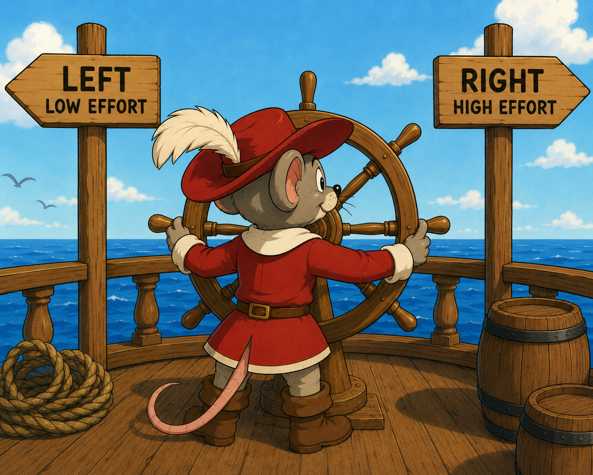

# Head-Fixed Discounting Bpod Task



Head-fixed **decision-making with effort** (wheel + force cue), implemented on **[bpod-core](https://github.com/int-brain-lab/bpod-core)** with StreamDIO hardware.

Design reference: [IBLRIG](https://int-brain-lab.github.io/iblrig/) (IBL two-alternative choice structure) plus the **force-discount wheel** paradigm from `MM_PyBpod2/examples/screen_shape_force_discount_task.py`.

## Hard Rule: Rig Contract

All pin/channel/timing defaults are defined in this repository, mainly in `src/hf_dm/hardware/bringup_constants.py` and `configs/*.yaml`. They match the hardware brought up with the MM_PyBpod2 notebooks:

| Notebook | What this repo uses |
|----------|---------------------|
| `rotary_encoder_bringup.ipynb` | DI01 pulse, DI03 direction, AI13 force (pin 14) |
| `screen_bringup_shape_force_discount.ipynb` | CW force ch3/pin21, CCW ch5/pin19, pump ch1/pin23 |
| `camera_bringup_pin32_ttl.ipynb` | StreamDIO camera 30 Hz, 10 ms exposure |
| `speaker_bringup_pin27_whitenoise.ipynb` | Continuous PC white noise, gated by Bpod serial action on pin 27 |
| `cap_touch_bringup_pin15_power_pin14_touch.ipynb` | Cap-touch power output ch13/pin15; lick edges on input ch14/pin25 |
| `frame2ttl_v3_bringup_di05_pin6.ipynb` | Frame2TTL v3 TTL output into StreamDIO DI05 / pin 6 |

The task does not read rig parameters from a sister checkout. MM_PyBpod2 is needed as an installed
driver package for `pybpod_streamDIO_module` unless that driver is deliberately vendored later.

Ports default to `AUTO` with the same discovery logic as the screen task.
Cap-touch power is held high for the whole session. Input channel 14 is enabled in the StreamDIO
digital stream; each configured high edge is stored both as a raw module-timestamped event and as
an explicit `lick` session event while force remains sampled on AI13.

The `pybpod_rotaryencoder_module` is deliberately not used in runtime here: this rig reads wheel
pulses through StreamDIO DI01/DI03, not the Sanworks Bpod rotary module. A legacy adapter would need
to be mutually exclusive with the StreamDIO wheel path.

## Architecture

```
Session supervisor (Python)
  - pygame display coupled to wheel position at display FPS
  - StreamDIO rotary, force, lick, and camera TTL streams
  - verified StreamDIO USB commands for force, pump, and cap-touch power
  - continuous PC white noise held behind the pin-27 hardware gate
  - required headless Spinnaker recording for the whole session
  - full raw StreamDIO NPZ stream plus JSON/NPZ trial and event records
  - wall timestamps plus high-resolution monotonic `perf_counter` timestamps

Bpod-core trial FSM
  - installs the full firmware module/USB event allocation during bringup
  - owns 3 s wheel quiescence, 20 s choice `Tup`, blank, reward, timeout, and exit
  - receives host SoftCodes only for wheel movement during quiescence and committed choices
  - triggers verified pump/force host actions with output SoftCodes
  - directly gates timeout white noise with its Serial-module pin-27 action
```

**Trial timeline (decision_making phase)**

1. Bpod requires **3 s wheel quiescence**; any streamed wheel movement sends a reset SoftCode.
2. Bpod enters a **20 s ChoiceWindow**. Its `Tup` is the authoritative timeout.
3. A star (high effort/high reward) and circle (low effort/low reward) begin on opposite lateral sides.
4. The live Python loop reads StreamDIO and redraws at 60 Hz. Turning right moves only the left option
   toward center; turning left moves only the right option toward center.
5. Star/circle side is randomized each trial. The masks contain exactly the same number of lit pixels.
6. On a centered choice, Python sends one high/low SoftCode. Bpod immediately enters the blank state,
   turns force off, waits `choice_blank_s`, enters the appropriate pump state, then holds a final
   `post_reward_s` state before exiting.
7. On timeout, Bpod enters the timeout state directly, gates audible white noise on pin 27, gates it
   off after `timeout_noise_s`, holds `post_timeout_s`, and exits.
8. A fresh Bpod FSM starts the next trial. There is no host-side choice wait or extra decision-task ITI.

Pump and effort outputs retain the low-latency, verified StreamDIO USB path and require both a USB
acknowledgement and a timestamped physical `dio_output` event. Bpod controls when those actions occur
through state-entry output SoftCodes.

## Install

```bash
cd /path/to/bpod-hf-dm
python -m venv .venv
source .venv/bin/activate   # Windows: .venv\Scripts\activate

pip install -e /path/to/bpod-core
pip install -e /path/to/MM_PyBpod2_andrestrocyte   # StreamDIO + optional sound module
pip install -e .
# optional offline preview-video exporter:
pip install -e .[video]
# optional MM-style cold-path helpers used by some rigs:
pip install -e .[mm]
```

Requires Python >= 3.10, Windows rig (same as bringups), Bpod State Machine 2+.

### Headless Spinnaker recording (no SpinView)

Install the **Teledyne/FLIR Spinnaker SDK** and set `camera.backend: spinnaker`. The recorder uses
`PySpin` when a compatible binding is installed and automatically falls back to the installed
Spinnaker C API when it is not. Both paths configure the verified bringup trigger contract:
`FrameStart`, `Line0`, rising edge, and `TriggerWidth` exposure.

Example:

```yaml
camera:
  frequency_hz: 30
  exposure_us: 10000
  record_video: true
  required: true
  backend: spinnaker
  serial_number: null      # optional: choose a specific camera
  pixel_format: Mono8
  roi_width: null           # optional Spinnaker ROI crop; null keeps full sensor
  roi_height: null
  roi_offset_x: null
  roi_offset_y: null
  acquisition_timeout_ms: 1000
  save_dir: data/videos
```

Optional cold-path video exports are controlled separately:

```yaml
video:
  record_video: true              # also accepted here; camera.record_video stays compatible
  export_spinnaker_summary: true
  duplicate_preview_video: false  # opt-in offline FFV1 AVI from saved PGM frames
```

Optional MM-inspired integrations remain cold-path:

```yaml
integrations:
  mm_soundcard_status: true
  mm_alyx_register: false         # uses ALYX_API_URL/ALYX_TOKEN or alyx_* fields
  mm_flir_roi_gui: true           # no-argument camera-roi-setup opens visual selection
```

The session writes a frame sequence, `frame_timestamps.csv`, and `recording_summary.json` under
`data/videos/<subject>_<phase>_<timestamp>_spinnaker/`. The summary includes saved frames,
duration, mean saved FPS, requested trigger rate, exposure, preview delivery counts,
incomplete/timeout/save-error capture counters, and a conservative estimated missing-trigger count.
With `required: true`, the task refuses to run if
recording cannot start. The optional preview AVI is generated only after frames are already saved,
through `hf-dm export-preview-video` or `video.duplicate_preview_video: true`; it is never written
from the live camera callback.

### Operator monitor GUI

The official configs enable a separate lightweight monitor on the computer/main screen
(`monitor.display_index: 0`), while the task stimulus remains on the behavior display
(`display.display_index: 1`). The monitor runs in its own process and receives only nonblocking,
drop-safe telemetry, so closing or slowing the GUI does not stall the Bpod/StreamDIO task loop.

It shows a low-rate camera preview, a compact left-rotated task screen copy, the active Bpod FSM
state, a one-row rolling history of the latest 10 star/circle/timeout outcome icons,
lick-edge/pump/noise event rails, raw cap-touch
pin status, a live force-effort ADC trace with a session-held y-axis maximum, and the wheel trace
reset every trial.
Use `--no-monitor` for command-line checks, or `--monitor` to force it on when a YAML file has it
disabled. `--simulate-headless` disables the monitor automatically.

When `monitor.record_path: auto`, the monitor child process writes compact JSONL telemetry to
`exports/monitor_telemetry.jsonl` in the session bundle. Frame byte payloads are replaced by byte
counts, and task-side publishing remains nonblocking queue insertion.

Cap touch uses StreamDIO input channel 14 / physical pin 25 for the lick detector and output
channel 13 / physical pin 15 for detector power. The GUI shows both the power output and the raw
input channel value so detector transitions are visible even before trial-level counted licks.
Because the firmware can stream only one configured analog input at a time, force remains on analog
channel 13 and the vendored StreamDIO firmware in `firmware/` digitizes cap-touch pin 25 locally
into normal channel-14 high/low input events. Flash that firmware if the detector LED changes but no
lick events appear in the GUI. With firmware version 3 or newer, the operator monitor also polls the
firmware digitizer status at low rate so the cap-touch ADC value/baseline is visible without moving
force off analog channel 13. The same monitor thread records a bounded StreamDIO module-status
snapshot every `monitor.streamdio_status_interval_s` (30 seconds in the official configs); the
latest module and cap-touch status plus snapshot counts are retained in the StreamDIO summary.

## Run

```bash
# No-trial hardware preflight: Bpod/StreamDIO/Spinnaker streams and cleanup only.
python -m hf_dm.cli --config configs/dm_50.yaml --preflight --preflight-duration 2

# Controlled live check. WARNING: activates real force, pump, speaker, camera, and StreamDIO.
python -m hf_dm.cli --config configs/dm_50.yaml --hardware-self-test

# Cap-touch input check only. Touch the lick detector during the window.
python -m hf_dm.cli --config configs/dm_50.yaml --cap-touch-diagnostic --cap-touch-duration 15

# Frame2TTL photodiode check only. Flashes the lower-right sync square and counts DI05 edges.
python -m hf_dm.cli --config configs/dm_50.yaml --frame2ttl-diagnostic --frame2ttl-flips 20

# Frame2TTL barcode check only. Displays representative slow count barcodes and reports decode/match accuracy.
python -m hf_dm.cli --config configs/dm_50.yaml --frame2ttl-barcode-diagnostic

# Bpod -> StreamDIO opcode check only. Sends state-marker serial messages without task outputs.
python -m hf_dm.cli --config configs/dm_50.yaml --bpod-opcode-diagnostic

# Stage 1 - centering shaping (bring a lateral cue into the center target)
python -m hf_dm.cli --config configs/centering_50.yaml

# Stage 2-4 - full DM (50 / 100 / 200 trials)
python -m hf_dm.cli --config configs/dm_50.yaml
python -m hf_dm.cli --config configs/dm_100.yaml
python -m hf_dm.cli --config configs/dm_200.yaml

# Same tasks without the operator GUI
python -m hf_dm.cli --config configs/dm_50.yaml --no-monitor
```

Outputs: `data/sessions/<subject>_<phase>_<timestamp>.npz` and `.json`. By default the
session also writes a cold-path bundle next to those files:
`data/sessions/<subject>_<phase>_<timestamp>_bundle/manifest.json`,
`config.snapshot.yaml`, `exports/`, `bpod_exports/`, and `continuous_streams/`.
These derived files are written after the primary NPZ/JSON save; the StreamDIO,
force, camera, and task loops never append CSV rows in the hot path.

On this Windows rig, `python -m hf_dm.cli ...` is the reliable launcher. An editable user-site
install may place `hf-dm-run.exe` under `%APPDATA%\Python\Python312\Scripts`, which is not always on
PowerShell's `PATH`.

### Hardware-free simulation

Use this before touching the live rig to verify the real Bpod-style state sequence, screen motion,
reward timing, timeout gate, lick logging, camera TTL bookkeeping, and cleanup/finalization:

```bash
python -m hf_dm.cli --config configs/dm_50.yaml --simulate --simulate-headless --simulate-trials 3 --simulate-choice-mode alternate
```

Drop `--simulate-headless` to open the pygame task window. Choice modes are `matched`, `opposite`,
`timeout`, `cw`, `ccw`, and `alternate`. In the decision task, matched means star/high-effort and
opposite means circle/low-effort.

### Live rig troubleshooting

This task uses its own bpod-core settings namespace under `data/runtime/bpod-core`, so unrelated
services using the global bpod-core settings lock do not block it. Override the location with
`HF_DM_BPOD_CORE_CONFIG_DIR`. If the task-specific lock is held, close the older `hf_dm.cli` task
process and rerun the preflight.

If StreamDIO reports `Access is denied` on COM7/COM8, another process owns the StreamDIO USB port.
Close old notebooks, serial monitors, or task processes, then unplug/replug StreamDIO if needed.

`--cap-touch-diagnostic` does not start Bpod trials. It opens StreamDIO, keeps force streaming on
analog channel 13, powers the cap-touch detector on output channel 13 / pin 15, polls the firmware
digitizer on input channel 14 / pin 25, and prints ADC value, baseline, threshold, and high/low lick
edge counts. If `hi_edges` increments while touching the detector, the task GUI should also show
licks. If ADC stays near zero or `hi_edges` never increments while the detector is touched, check
the cap-touch sensor wiring/power first, then the firmware threshold.
Firmware v4 supports runtime threshold tuning from YAML:

```yaml
licks:
  cap_touch_min_high_threshold: 250
  cap_touch_delta_high: 120
  cap_touch_delta_low: 90
```

or for one diagnostic run:

```bash
python -m hf_dm.cli --config configs/dm_50.yaml --cap-touch-diagnostic --cap-touch-min-high-threshold 250 --cap-touch-delta-high 120 --cap-touch-delta-low 90
```

To reproduce the old bringup-style analog readout, temporarily stream cap-touch
pin 25 as the single analog input:

```bash
python -m hf_dm.cli --config configs/dm_50.yaml --cap-touch-diagnostic --cap-touch-raw-analog --cap-touch-duration 15
```

That mode disables the force ADC only for the diagnostic. During the task, force
stays on analog channel 13 and cap touch is digitized locally in firmware.
The diagnostic report includes a `diagnosis` field such as
`raw_adc_swing_detected`, `raw_adc_below_threshold`,
`digitizer_edges_detected`, or `digitizer_adc_below_threshold`.

### Frame2TTL screen sync

The official configs enable Frame2TTL v3 on StreamDIO DI05 / physical pin 6. The task draws a
64 px sync square in the lower-right corner of the behavior screen, with size, margin, corner,
input channel, and input pin controlled by the `frame2ttl:` YAML block.

At the beginning of each Bpod decision trial, the square emits a slow two-group pulse-count barcode
during the existing quiescence period. The first group encodes modality (force/risk/delay/other) and
the second group encodes trial kind (free left/right, forced-star left/right, forced-circle
left/right). Pulses and short gaps are 6 frames each at 60 Hz, with 12-frame preamble/separator
intervals, so the worst case is about 2.6 s. During the choice window the same square alternates
black/white only when a wheel movement changes the rendered cue positions; if the cues do not move,
the display is polled but no new frame is flipped.

The production Bpod decision FSM also inserts 1 ms `*_Pre` transition states before each task state.
Those pre-states send preloaded StreamDIO state-marker messages (`[ord("S"), state_id]`, message IDs
50+) so the module timestamps trial-state transitions as `bpod_state` events.

The operator monitor includes a Frame2TTL readout in the inputs/events panel: live DI05 edge ticks,
last TTL state, channel/pin labels, and latest barcode decode/match status. The Bpod FSM panel also
shows a rolling color-coded transition-opcode timeline from StreamDIO `bpod_state` events. Raw DI05
transitions remain in the NPZ `streamdio_events` array as `dio_input` events on channel 5.
Before running trials, use `--frame2ttl-diagnostic` to confirm the photodiode sees both black and
white transitions at the configured lower-right patch location, `--frame2ttl-barcode-diagnostic`
to verify barcode decode/match accuracy, and `--bpod-opcode-diagnostic` to verify Bpod state-marker
timestamps reach StreamDIO.

`--hardware-self-test` runs the production Bpod FSM with synthetic wheel choices but real rig
outputs. It fails unless both effort directions and pump transitions have firmware output events,
choice-to-pump timing matches the configured blank state, pump duration error is below 10 ms, force
ADC and camera TTLs are present, the Bpod timeout gate completes, Spinnaker saves frames, and there
are no choice-loop stalls or incorrectly decoded Bpod states. Licks and real wheel edges still
require touching/turning the physical inputs.
For an input check, run a longer `--preflight`, turn the wheel both ways, and touch the lick sensor;
the saved `preflight_end` event reports wheel pulse/direction edges and cap-touch input edges.

## Data logged

- Per-trial: star/circle sides, chosen shape/side, force direction, choice, reward duration, RT, pulses, force ADC stats, licks, wall/mono timestamps, camera TTL list/interval QC, Frame2TTL barcode/edge summary
- Exact bpod-core state/event rows for every trial in JSON and NPZ `bpod_trials_json`
- Raw NPZ `streamdio_events`: every wheel/direction edge, force sample, camera TTL, lick, module timestamp, and high-resolution host timestamp
- Events: `session_start`, `trial_start`, `stimulus_on`, `force_on`, `choice_detected`, `feedback_on`, `frame2ttl_*`, `pump_start`, `pump_end`, `output_actual`, `lick`, `white_noise_*`, cleanup, `trial_end`, `session_end`
- Video: every camera frame with camera and host timestamps in `frame_timestamps.csv`
- Session summary: end reason (`completed`, `idle_timeout`, `max_consecutive_failures`)

### Session export bundle

The `session_export:` YAML block controls derived data products:

```yaml
session_export:
  layout: mm_hierarchy         # production default; flat remains available
  manifest: true
  config_snapshot: true
  export_csv_on_finalize: true
  export_timeline: true
  streamdio_chunk_s: 0         # dm_200 uses 45 seconds
  streamdio_memory_mode: full  # dm_200 uses bounded; full suits shorter tasks
  streamdio_recent_events: 50000
```

`layout: mm_hierarchy` is the production default and writes into
`data/sessions/<phase>/<subject>/<YYYY-MM-DD>/<run_id>/session.npz`.
`layout: flat` remains available for legacy primary artifact paths and creates a per-session
`*_bundle/` directory.

The bundle includes:

- `manifest.json`: relative artifact paths, SHA256 hashes, source config SHA256 when available,
  package/git info, hardware flags, StreamDIO firmware info, final counts, video summary with
  `recording_summary.json` / `frame_timestamps.csv` artifacts when present, a StreamDIO chunk
  index when chunking is enabled, and recorder stats including primary and derived artifact byte
  counts
- `config.snapshot.yaml`: source config path, source YAML text and SHA256 when available,
  recorded CLI/config overrides, plus the effective post-CLI config
- `videos/spinnaker_video.json`: a bundle-local pointer to the Spinnaker recording directory,
  summary JSON, frame timestamp CSV, and their hashes; frame files are not duplicated
- `exports/streamdio_events.csv`, `force_trace.csv`, `camera_ttl.csv`, `frame2ttl_edges.csv`, `licks.csv`, `trials_summary.csv`, `events.csv`
- `exports/synchronized_timeline.csv` and `alignment_anchors.json`, including the first
  Spinnaker frame from `frame_timestamps.csv` when video timestamps are available
- `bpod_exports/bpod_trials_flat.csv`
- `bpod_data/bpod_trials.json`: exact captured bpod-core trial rows plus saved FSM definitions
- optional `continuous_streams/streamdio_chunk_NNN.npz` files when `streamdio_chunk_s > 0`
- `exports/soundcard_status.json` when the soundcard module reports white-noise playback status
- `exports/monitor_telemetry.jsonl` when the operator monitor is enabled with `record_path: auto`
- `exports/rig_preflight_report.json` after `hf-dm rig-preflight`, with the preflight summary,
  config, session artifact paths, StreamDIO counts/status, and preflight start/end event payloads
- `exports/alyx_registration.json` when `integrations.mm_alyx_register: true`; registration errors are recorded there and do not abort the session save
- `exports/debug_events_recent.json` when bounded debug telemetry exists; high-volume debug samples
  such as individual choice-loop stalls stay out of the main semantic event list, while aggregate
  counts remain in `TrialRecord` and manifest `recorder_stats`

The official `dm_200` profile sets `streamdio_chunk_s: 45` and
`streamdio_memory_mode: bounded`. For other very long sessions, enable the same pair. The live task
then keeps only the most recent `streamdio_recent_events` rows in memory, writes completed chunks in
a daemon thread, and reconstructs the full primary NPZ/CSV/timeline from those chunks at finalize.

For future cold-path tools, `hf_dm.data.session_bundle.SessionBundle` provides a small
`start() / register_streamdio() / register_camera() / get_stream_summaries() / finalize()` facade over `SessionRecorder`.
As a context manager it finalizes an otherwise-unfinalized recorder on exit, including error exits.
It is a wrapper only; the live task continues to use the existing recorder and StreamDIO paths.

Offline helpers:

```bash
hf-dm export-session data/sessions/<session>.json
hf-dm validate-session data/sessions/<session>_bundle
hf-dm export-preview-video data/videos/<session>_spinnaker
hf-dm export-session data/sessions/<session>.json --export-preview-video
hf-dm rig-preflight --config configs/dm_50.yaml --duration 2 --no-monitor
hf-dm camera-roi-setup --config configs/dm_50.yaml --output configs/dm_50_roi.yaml --width 640 --height 480 --offset-x 0 --offset-y 0
hf-dm camera-roi-setup --config configs/dm_50.yaml --output configs/dm_50_roi.yaml --interactive
hf-dm camera-roi-setup --config configs/dm_50.yaml --output configs/dm_50_roi.yaml --visual

hf-dm-export-session data/sessions/<session>.json
hf-dm-validate-session data/sessions/<session>_bundle
```

Visual ROI setup temporarily opens the configured FLIR camera in full-frame, free-running mode,
captures a frame, and lets OpenCV select a rectangle. Width, height, and offsets are snapped to the
camera node increments before writing YAML. Cancelling leaves the file untouched. With
`integrations.mm_flir_roi_gui: true`, omitting ROI numbers selects visual mode automatically.

`validate-session` checks manifest paths, byte sizes, and SHA256 hashes, verifies source-config
provenance from `config.snapshot.yaml`, opens NPZ artifacts, verifies the primary session NPZ schema/counts,
validates StreamDIO chunk NPZs and their manifest index, checks known CSV row counts including Bpod
flat rows and timeline schema/order, parses JSON/JSONL sidecars including monitor telemetry, and
checks derived Bpod/video recording summary/pointer/preview, Alyx registration, debug-event ring,
rig-preflight report, recorder stats, hardware flags, timeline anchor, stream/module/status JSON counts and
consistency.

## Learning curricula

- **[docs/CURRICULUM_BPOD_CORE.md](docs/CURRICULUM_BPOD_CORE.md)** - become fluent in bpod-core using this repo
- **[docs/CURRICULUM_TRAINING.md](docs/CURRICULUM_TRAINING.md)** - mouse training stages (centering -> 50 -> 100 -> 200)

## License

MIT
